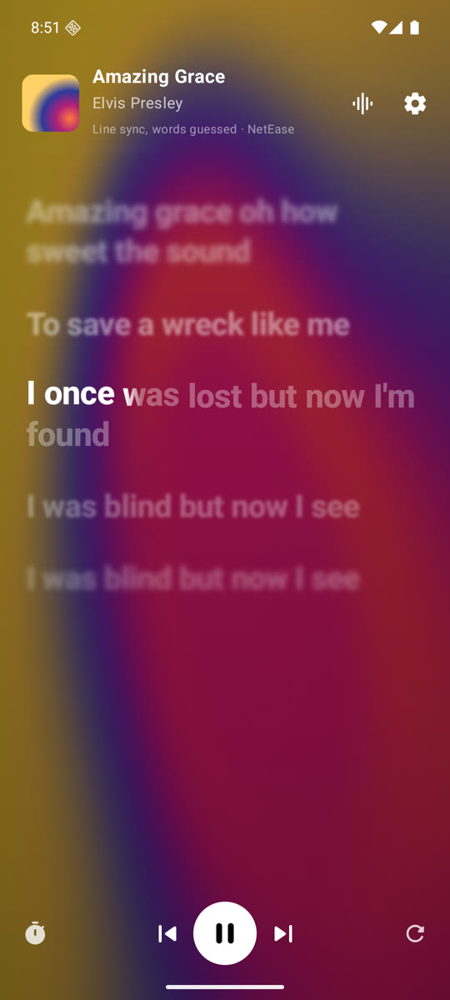
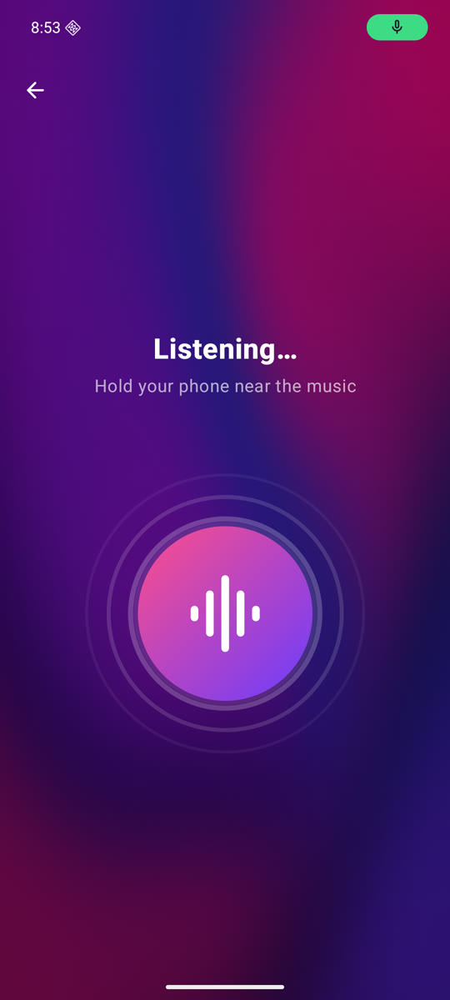
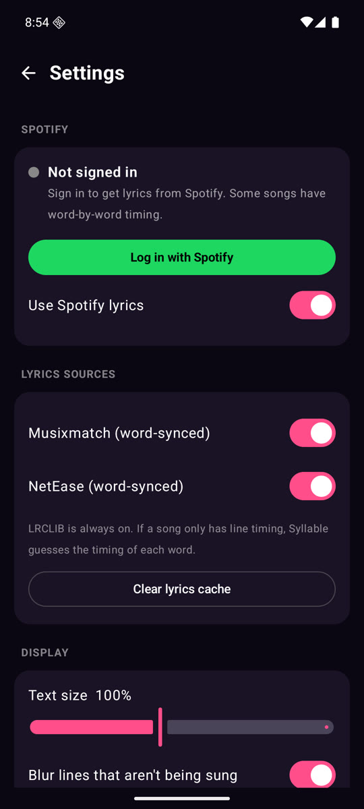
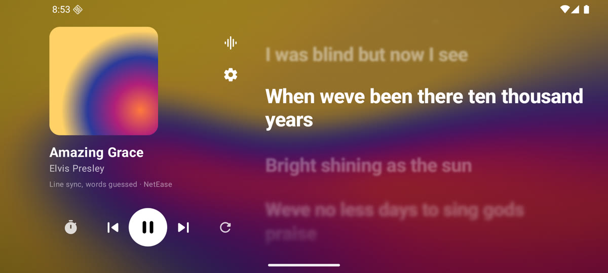

# Syllable

Syllable is an Android app that shows the lyrics of the song you're listening to and highlights each word as it's sung.

<p>
  
  
  
</p>



The song in the screenshots is "Amazing Grace", whose words are in the public domain. The cover is a test image.

## Features

- **Now playing.** Give Syllable notification access and it picks up the song from any music app (Spotify, YouTube Music, Chrome and others), along with how far into the song you are. Tap a line to jump to it. The bar at the bottom has play, pause and skip.
- **Identify a song.** Tap the listen button and Syllable uses the mic to find the song playing near you, like Shazam. Then press **Lyrics**. The lyrics start at the right spot. If they drift, you can pause them or shift them earlier or later.
- **Word by word.** Each word fills in as it's sung, and long notes glow. Lines move in a soft wave as the song goes on.
- **Timing per device.** Syllable knows whether you're listening on the phone speaker, wired or USB headphones, Bluetooth, or casting to another device. If the lyrics run early or late, shift them once with the timing button and Syllable remembers it for that device. Bluetooth devices start with lyrics 0.2s later, since Bluetooth audio arrives a little late. You can change that default, or forget a saved device, in Settings.
- **Duets and background vocals.** With Spicy Lyrics, a second singer's lines sit on the right, and background vocals fill in under the main line at their own pace.
- **Moving background.** The album art is blurred into a slowly flowing gradient, like the Spicy Lyrics extension for Spotify. It slows down when the music is paused. For songs found with the mic, Syllable uses Spotify's album art when you're signed in.
- **Landscape.** Turn your phone sideways to see the album art and controls next to the lyrics.

## Where the lyrics come from

Syllable tries these in order and uses the first one with timing for each word. If none has it, it uses the first one timed by line, then plain text. It asks them all at once, so this doesn't slow anything down.

| Source | Timing | Notes |
| --- | --- | --- |
| Spicy Lyrics | Word or line | Community syncs, then Apple Music and Spotify. Has duets and background vocals. Needs an API key (see below). |
| Spotify | Word or line | Optional. Sign in from **Settings → Log in with Spotify**. Syllable keeps you signed in. |
| Musixmatch | Word or line | Works without an account. It sometimes stops answering for a while. |
| NetEase Cloud Music | Word or line | Has lots of Western and Asian songs. |
| LRCLIB | Line, sometimes word | Always on. |

If a song only has line timing, Syllable guesses when each word is sung from its length.

### Spicy Lyrics key

Spicy Lyrics needs a free key from [developers.spicylyrics.org](https://developers.spicylyrics.org). You can paste your own in **Settings → Spicy Lyrics**, or build it into the app by putting it in `spicy.properties` in the project root. Git ignores this file.

```properties
key=sl_pk_...
```

A key that ships inside an app should be a client key (`sl_pk_`). Make one under **Client access** on your application page, with "Allow requests with no Origin header" turned on, since Android apps don't send that header. The end of the lyrics shows where they came from, and for community syncs, who uploaded and made them. The Spicy Lyrics terms ask for this. They also limit how long lyrics can be kept, so Syllable clears cached lyrics after 30 days.

## Song recognition

`ShazamSignature.kt` is a Kotlin version of the open-source Shazam fingerprint code from SongRec and shazamio. A unit test checks that it gives exactly the same output as the Python version on a test signal. Syllable records at 16 kHz mono and tries to find a match after 4, 8 and 12 seconds.

## Build

You need JDK 17 or newer and the Android SDK (compileSdk 37).

```bash
./gradlew :app:assembleDebug
./gradlew :app:testDebugUnitTest
```

Release builds are signed with the key named in `keystore.properties` in the project root. Git ignores this file.

```properties
storeFile=release.jks
storePassword=…
keyAlias=syllable
keyPassword=…
```

If the file is missing, release builds use the debug key.

## Notes

The background follows the approach of [Kawarp](https://github.com/better-lyrics/kawarp) (MIT), the renderer behind Spicy Lyrics' background. On Android 12 and older, the blurred art turns slowly instead.

Spicy Lyrics is used through its public developer API. Syllable uses unofficial Spotify, Musixmatch, NetEase and Shazam endpoints. They can change or limit requests at any time. This project isn't connected to any of these companies.
